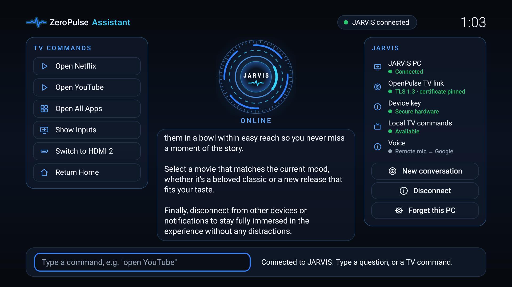

# ZeroPulse TV

A fast, minimal home screen for Android TV: a dock of your favourite apps over rotating nature wallpapers,
one-click access to your TV's inputs, and an optional, experimental **JARVIS** assistant that talks to an AI
running on **your own PC**.

**Status: public beta — v2.1.0-beta.1.** Tested on one device (TCL G10, Google TV, Android 12), as an
update of an earlier build. **Fresh installs on other devices are unverified** — please report how it goes.
Read [COMPATIBILITY.md](COMPATIBILITY.md) before installing.

## Features

- **Home**: clock, greeting, a dock of your favourite apps (reorder, add, remove), a photo credit for
  every wallpaper. Remote-first navigation; no touch needed.
- **Wallpapers**: 9 nature photographs (Wikimedia Commons, CC BY-SA) and 3 original artworks, bundled in
  the APK so they work offline; rotation every 30 s – 15 min or off.
- **Apps and Inputs**: every installed TV app, and the TV's HDMI/tuner inputs with their connection state.
- **Assistant (local)**: typed TV commands such as "open YouTube", "inputs" or "switch to HDMI 2" — handled
  on the TV, no network.
- **JARVIS (optional, experimental)**: pair the TV with your own [OpenPulse](https://github.com/steventa2024-lgtm/openpulse)
  gateway on your PC and chat with the AI model you run there. See [JARVIS](#jarvis-optional).
- **Settings**: appearance, wallpapers, dock, assistant, shortcuts to Android TV settings; About lists all
  photo credits.
- **Small and private**: no ads, no analytics, no third-party libraries; one permission (`INTERNET`, used only
  by JARVIS). See [PRIVACY.md](PRIVACY.md).

| | | |
|---|---|---|
|  |  |  |
|  |  |

All screenshots are from a real TCL TV running this release.

## Install

Download `ZeroPulseTV-v2.1.0-beta.1.apk` from the [Releases](https://github.com/steventa2024-lgtm/ZeroPulseTV/releases)
page, **check its SHA-256**, and sideload it. Step-by-step instructions, including how to go back to your
original home screen: [INSTALL.md](INSTALL.md).

ZeroPulse TV installs as a normal app. It does not remove, disable or change anything else on your TV.
Making it the TV's *Home* screen is device-dependent — on Google TV it needs advanced steps (see INSTALL.md).

## JARVIS (optional)

JARVIS is an **optional, experimental** feature. Without it, ZeroPulse TV is a complete launcher.

- It needs **your own** PC running a compatible OpenPulse gateway with the *TV link* enabled. There is **no
  shared AI server**: the TV only talks to the PC you pair it with, on your local network.
- **No language model is bundled** and **no paid AI API key** is needed for the launcher. Answers come from
  whatever model your OpenPulse gateway uses (for example a local Ollama model).
- Pairing is **secured**: TLS 1.3 with the PC's certificate pinned, a one-time code shown on the PC, and an
  explicit approval on the PC. The TV's key is kept in Android Keystore.
- From the TV, JARVIS can only chat. It has no access to your PC's files, commands or settings; app, input and
  Home suggestions appear as buttons that run only when you press OK.
- **Voice control is not implemented** in 2.1. The remote's microphone button still opens Google.

> **Beta note:** the OpenPulse *TV link* that JARVIS needs is not yet in a public OpenPulse release.
> Until it is, JARVIS shows "Not paired" and the rest of the launcher works normally. Protocol: [docs/JARVIS.md](docs/JARVIS.md).

## Verify the download

| | |
|---|---|
| File | `ZeroPulseTV-v2.1.0-beta.1.apk` |
| SHA-256 | `ac6ac5a49fa1617b155d048ad17aaeea8bc74fc47ac195ca823d6bd5d52f0401` |
| Package | `tv.calmhome.launcher` · versionCode 21 · versionName 2.1 |
| Signing certificate SHA-256 | `0D:6A:6F:7B:25:4E:84:00:3D:DB:FC:27:42:33:EC:DC:0B:8F:8A:F5:44:21:14:F0:72:26:7B:71:46:DE:E4:CD` |

Details and commands: [release/v2.1.0-beta.1/RELEASE_NOTES.md](release/v2.1.0-beta.1/RELEASE_NOTES.md).

## Build from source

Plain Android SDK command-line tools, no Gradle and no dependencies: [docs/BUILDING.md](docs/BUILDING.md).
Unit tests: `powershell -ExecutionPolicy Bypass -File qa\run-tests.ps1`.

## Repository

| Path | Contents |
|---|---|
| `launcher/` | Android TV app: manifest, Java sources, resources, bundled wallpapers, build script |
| `qa/` | JVM unit tests (core logic, JARVIS protocol/crypto) and the TV-client ↔ OpenPulse integration test |
| `branding/` | Logo files and the generator for the original wallpapers |
| `docs/` | Building, architecture, JARVIS protocol, screenshots |
| `release/` | Release notes and checksums per version |

## Documents

[INSTALL](INSTALL.md) · [COMPATIBILITY](COMPATIBILITY.md) · [CHANGELOG](CHANGELOG.md) · [SECURITY](SECURITY.md) ·
[PRIVACY](PRIVACY.md) · [THIRD_PARTY_NOTICES](THIRD_PARTY_NOTICES.md) · [LICENSE](LICENSE)

ZeroPulse TV is an independent project. It is not affiliated with Google, TCL or any streaming service;
their names and logos belong to their owners and appear only because the launcher shows the apps you have
installed.
