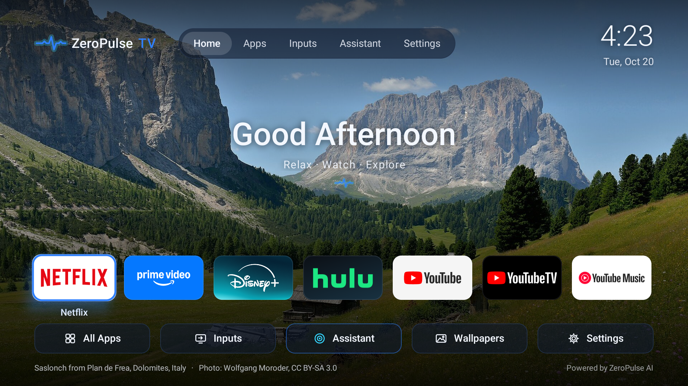
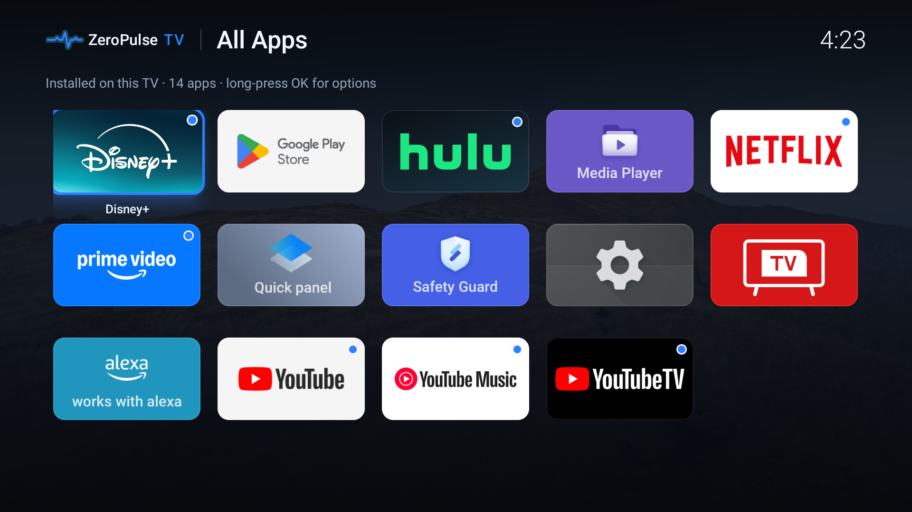
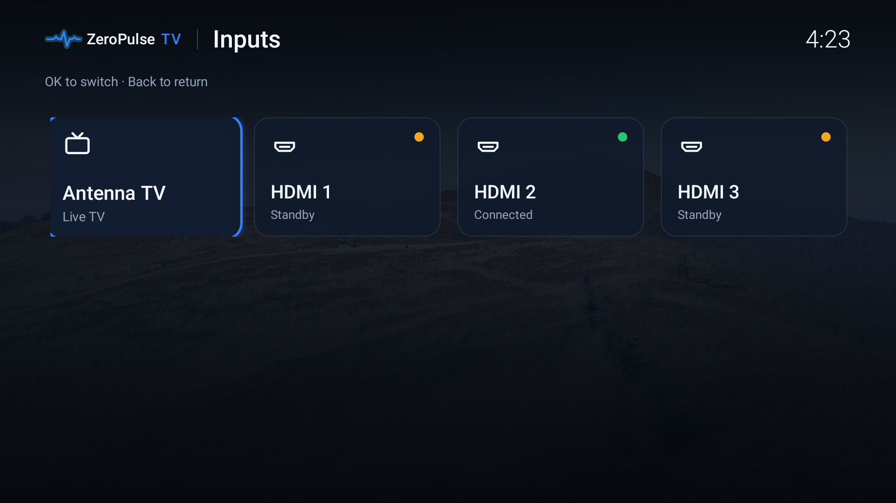
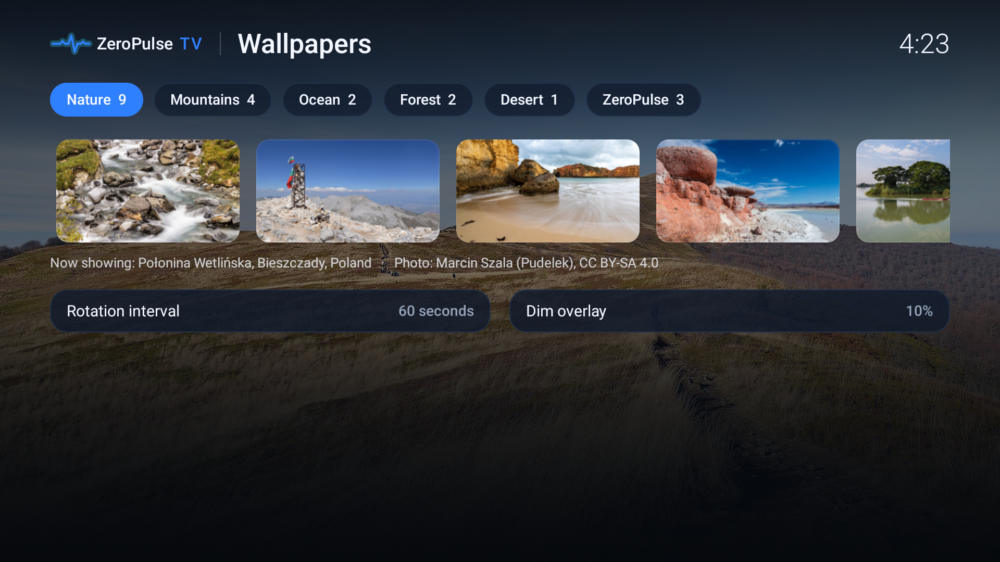
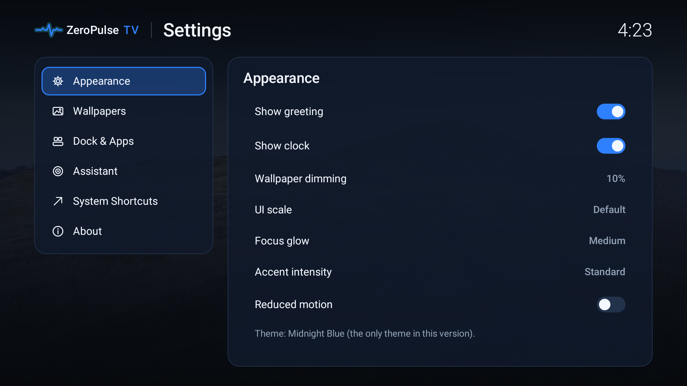
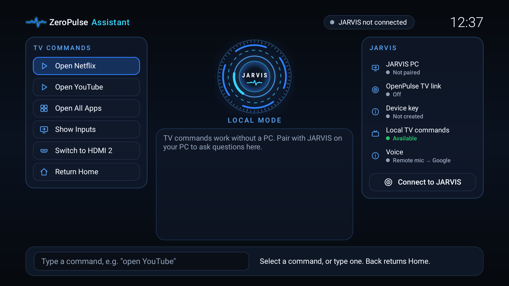
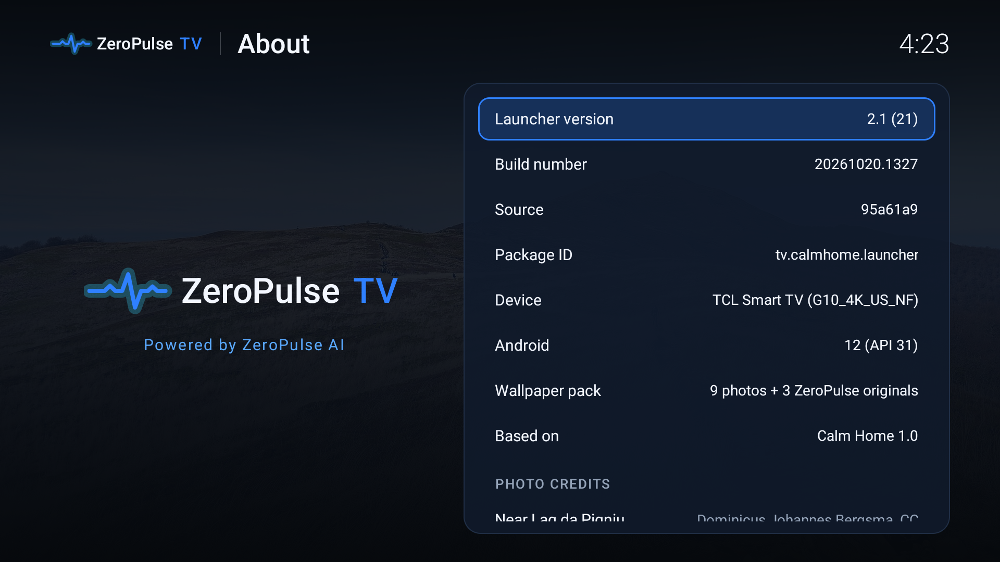

<p align="center">
  
</p>

<h1 align="center">Your TV. Your home.</h1>
<p align="center">A calmer home screen. Your favourite apps. A setup you control.</p>

<p align="center">
  <a href="https://github.com/steventa2024-lgtm/ZeroPulseTV/releases/tag/v2.1.0-beta.1"></a>
  <a href="LICENSE"></a>
  <a href="COMPATIBILITY.md"></a>
  <a href="COMPATIBILITY.md"></a>
</p>

<p align="center">
  <a href="https://github.com/steventa2024-lgtm/ZeroPulseTV/releases/download/v2.1.0-beta.1/ZeroPulseTV-v2.1.0-beta.1.apk"><strong>Download APK</strong></a> ·
  <a href="#guided-setup-with-claude-code"><strong>Guided setup</strong></a> ·
  <a href="https://zeropulse-tv.vercel.app/">Website</a> ·
  <a href="INSTALL.md">Install &amp; recovery</a> ·
  <a href="https://github.com/steventa2024-lgtm/ZeroPulseTV/issues">Feedback</a>
</p>

<p align="center"></p>
<p align="center"><sub>Actual capture from the maintainer’s TCL G10. Not a generated interface mockup.</sub></p>

> **Public beta, not universal TV support.** Version `v2.1.0-beta.1` was tested as an in-place update on **one TCL G10 running Google TV / Android 12**. Fresh installs, other devices and their default-Home behavior remain unverified. Read [compatibility](COMPATIBILITY.md) before installing.

## A home screen built around watching

**ZeroPulse TV** is a free, MIT-licensed Android TV launcher by ZeroPulse. It puts your installed apps over rotating nature wallpapers, with clear remote navigation and quick access to supported inputs. The core experience works offline and does not require an account or a running computer.

| Your apps | Your atmosphere | Your remote |
| --- | --- | --- |
| Pin, reorder and remove favourites from the dock. Removing a tile never uninstalls an app. | Nine credited nature photographs and three original artworks, bundled for offline use. | D-pad navigation, visible focus and quick controls for Apps, Inputs, Assistant, Wallpapers and Settings. |

The local Assistant also accepts typed TV commands such as “open YouTube” or “show inputs”. **JARVIS AI chat is optional and experimental; public pairing is not available yet.** [What is available today →](#jarvis-what-is-and-isnt-available)

Installing the APK adds a launcher. It **does not automatically debloat your TV**, remove ads inside streaming apps, include streaming subscriptions, or change your default Home app.

## Download

| Public beta | File |
| --- | --- |
| **ZeroPulse TV 2.1** · 5.74 MB | [Download the signed APK](https://github.com/steventa2024-lgtm/ZeroPulseTV/releases/download/v2.1.0-beta.1/ZeroPulseTV-v2.1.0-beta.1.apk) |
| Checksum | [SHA256SUMS.txt](https://github.com/steventa2024-lgtm/ZeroPulseTV/releases/download/v2.1.0-beta.1/SHA256SUMS.txt) |
| Changes and test scope | [Release notes](https://github.com/steventa2024-lgtm/ZeroPulseTV/releases/tag/v2.1.0-beta.1) |

Android 8.0 / API 26 is the minimum requirement, **not** a claim that every Android 8+ TV is compatible. The APK is sideloaded; it is not a Play Store download. Use the exact versioned release link above.

## Guided setup with Claude Code

**Prepare the TV → download on your computer → paste the prompt → approve and follow along.**

Claude Code runs the installation commands on **your computer**, over your own local network. The website does not connect to your TV. Keep Claude Code’s normal permission checks enabled. A cloud-only chat with no local shell or LAN access cannot perform this installation.

### 1 · On your TV

Open **Settings → System** or **Device Preferences → About**. Select **Android TV OS build / Build** seven times, then return to **Developer options**. Enable the debugging option your model supports.

Some TVs use **USB debugging** for network ADB; others expose **Network / ADB / Wireless debugging**, sometimes with a pairing code. The names, ports and availability vary. USB debugging alone does not guarantee Wi-Fi ADB support.

Keep the TV awake and on the same trusted Wi-Fi/LAN as your computer. Note its model and displayed IP address. Never expose ADB through your router or disable your firewall for this setup.

### 2 · On your computer

Download the official APK into a folder you can find. Open **local Claude Code** in that folder, then copy and paste the complete prompt linked below. Provide the APK’s full local path, your TV model and its IP/port when requested. Claude verifies the release before installing it; it does not build or re-sign a new APK.

### [Open the copyable Claude Code install prompt →](docs/claude-install-prompt.txt)

[Open as plain text](https://raw.githubusercontent.com/steventa2024-lgtm/ZeroPulseTV/main/docs/claude-install-prompt.txt) · [Official Claude Code setup](https://code.claude.com/docs/en/overview)

Your Claude account and usage are separate from this free launcher. Claude Code is an installation helper, not a runtime requirement. [Manual sideloading is also available.](INSTALL.md)

### 3 · Follow along

Approve the ADB authorization/pairing prompt on the TV for **your own computer**. Confirm the exact device, installation and preferred dock apps when Claude asks. The prompt directs Claude to record a baseline, preserve accessible backups, install the verified APK, test it and provide a device-specific recovery plan.

**Making ZeroPulse the default Home is a separate approval.** It may require OEM-specific changes; the TCL procedure is not a universal Android TV recipe. Keep the original launcher installed and understand the recovery route first.

After maintenance, disable debugging on the TV. `adb disconnect` alone does not turn off the TV’s network ADB listener.

> **What the prompt does not authorize:** uninstalling apps, clearing app data, factory resets, rooting, firmware changes, automatic debloating, or bypassing security prompts. Private app data may be inaccessible to ADB, so this is not a full-backup guarantee. The guided workflow itself has not been validated end-to-end on a fresh TV.

## A look around

<table>
<tr><td width="50%"><br><strong>All Apps</strong> — your installed TV apps.</td><td width="50%"><br><strong>Inputs</strong> — options reported by your device.</td></tr>
<tr><td><br><strong>Wallpapers</strong> — choose your scene and rotation.</td><td><br><strong>Settings</strong> — appearance and launcher preferences.</td></tr>
<tr><td><br><strong>Local Assistant</strong> — typed TV commands, no PC needed.</td><td><br><strong>About</strong> — version information and credits.</td></tr>
</table>

These are existing captures from the real TCL, not a compatibility demonstration for other models. Photo credits remain visible; see [third-party notices](THIRD_PARTY_NOTICES.md) for wallpaper attribution and licensing.

## JARVIS: what is and isn’t available

The TV-side experimental AI interface is included. Its compatible **OpenPulse TV link is not yet publicly released**, so public users cannot pair JARVIS today. It stays **Not paired**. The maintainer’s connected tests used a private gateway; they are not an available hosted service.

When the compatible gateway becomes public, the design uses the user’s own PC, explicit approval and certificate-pinned TLS. TV chat has no tools for executing PC commands or accessing PC files. Proposed TV actions require confirmation. No shared AI server or language model is bundled.

**Voice is not implemented in 2.1.** The core Home, wallpapers, apps, supported inputs and local typed commands work without JARVIS. [Protocol and availability details →](docs/JARVIS.md)

<details>
<summary><strong>Verify download &amp; technical details</strong></summary>

These values are **public fingerprints**, not secret keys. The APK checksum identifies the exact download; the certificate fingerprint identifies the public signing certificate. They do not enable someone to sign an update. Private keystores, passwords and pairing credentials must remain private.

| Item | Value |
| --- | --- |
| File | `ZeroPulseTV-v2.1.0-beta.1.apk` |
| Size | 5,744,160 bytes |
| APK SHA-256 | `ac6ac5a49fa1617b155d048ad17aaeea8bc74fc47ac195ca823d6bd5d52f0401` |
| Signing certificate SHA-256 | `0d6a6f7b254e84003ddbfc274233ecdc0b8f8af5442114f072267b7146dee4cd` |
| Package | `tv.calmhome.launcher` |
| App version | `2.1` · versionCode `21` |
| Minimum / target | API 26 / API 31 |
| Requested permission | `INTERNET` only |

**Windows PowerShell:**
```powershell
Get-FileHash .\ZeroPulseTV-v2.1.0-beta.1.apk -Algorithm SHA256
```
**macOS:**
```sh
shasum -a 256 ZeroPulseTV-v2.1.0-beta.1.apk
```
**Linux:**
```sh
sha256sum -c SHA256SUMS.txt
```
Optional signer check with Android SDK build-tools:
```sh
apksigner verify --print-certs ZeroPulseTV-v2.1.0-beta.1.apk
```
Do not install a mismatched file. Matching a checksum verifies integrity, not that software has no bugs. [Android signing documentation](https://developer.android.com/studio/publish/app-signing).

</details>

## Development and feedback

The Android app uses Java and Android SDK command-line tools. See [building from source](docs/BUILDING.md) and the `qa/` test suite. Development builds do not have the private release signing key and cannot silently replace an installed official build.

[Report a bug](https://github.com/steventa2024-lgtm/ZeroPulseTV/issues) with TV model, Android version and reproducible steps. Never include tokens, pairing codes, passwords or private logs. For vulnerabilities, follow [SECURITY.md](SECURITY.md) rather than opening a public issue with sensitive details.

[Install & recovery](INSTALL.md) · [Compatibility](COMPATIBILITY.md) · [Changelog](CHANGELOG.md) · [Privacy](PRIVACY.md) · [Security](SECURITY.md) · [Third-party notices](THIRD_PARTY_NOTICES.md) · [MIT license](LICENSE)

---

**Built by ZeroPulse.** Independent of Google, TCL, Anthropic and the streaming services shown. Names and app logos belong to their respective owners.
